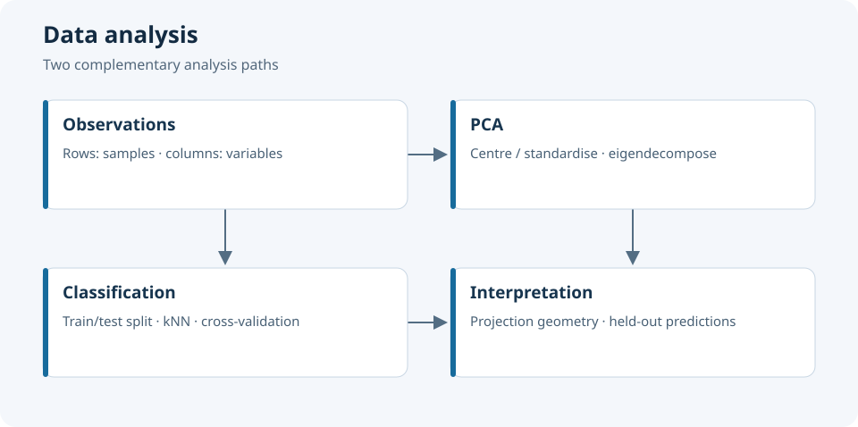

# Analyse de données

TP d'analyse de données et d'initiation au machine learning (Sup Galilée, 2024).

| Dossier | Contenu | Outils |
|---|---|---|
| [`ACP_MATLAB/`](ACP_MATLAB/) | Analyse en composantes principales : centrage-réduction, matrices de covariance et de corrélation, valeurs propres, projections | MATLAB |
| [`Initiation_Machine_Learning_Python/`](Initiation_Machine_Learning_Python/) | Jeu Iris, classifieur kNN, validation croisée pour choisir k, régression linéaire | Python, scikit-learn |

*Study overview: PCA and classification are complementary analysis paths.*

## Plans d’expériences

Le dossier [experimental_design/](experimental_design/) ajoute un exemple traité de plan factoriel complet : trois facteurs à deux niveaux, huit combinaisons et trois répétitions, puis essais au centre, interactions, régression et ANOVA. Le [guide en anglais](experimental_design/README.md) explique le modèle et les distinctions statistiques nécessaires pour lire les résultats du document original.

## Compétences
Statistiques multivariées, réduction de dimension, classification supervisée, validation croisée.

## Remarques
- Origine du jeu de données de l'ACP à vérifier avant publication (voir README du dossier).
- Aucune licence n'a été définie.
